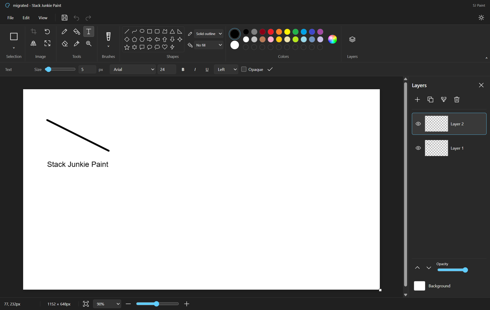

# Stack Junkie Paint

Stack Junkie Paint (SJ Paint) is a Microsoft Paint-inspired drawing app for Windows and Linux, with brushes, shapes, selections, text and layers. Windows is the primary desktop platform; a browser edition is available too.

Version: 0.2.1
<!-- sj-paint-version: 0.2.1 -->

SJ Paint is an independent implementation whose baseline goal is to match Microsoft Paint's appearance, features and behavior 1:1. That baseline is unfinished. Project-specific features come after the baseline is completed and verified. It is not a Microsoft product. The [parity ledger](PARITY.md) records implemented features, missing behavior and verification limits.



## Download

### Windows

Download the [v0.2.1 Windows x64 ZIP](https://github.com/stack-junkie/sj-paint/releases/download/v0.2.1/sj-paint-0.2.1-windows-x64.zip), extract it, and open `Stack Junkie Paint.exe` in the extracted folder. Keep the application files together.

The Windows executable is currently unsigned; it has no Authenticode signature.

### Linux

Download the [v0.2.1 Linux x64 archive](https://github.com/stack-junkie/sj-paint/releases/download/v0.2.1/sj-paint-0.2.1-linux-x64.tar.gz), then run:

```sh
tar -xzf sj-paint-0.2.1-linux-x64.tar.gz
./sj-paint/run-paint.sh
```

To install a copy for your user and add SJ Paint to the Linux application menu:

```sh
./sj-paint/install-linux.sh
```

The installer copies the app to `~/.local/opt/sj-paint`, creates `~/.local/share/applications/io.stackjunkie.sjpaint.desktop`, and installs icons under `~/.local/share/icons/hicolor/`. It does not require a system-wide installation.

Both portable archives bundle Electron, so Node.js is not needed to run them. SHA-256 checksums are included on the [release page](https://github.com/stack-junkie/sj-paint/releases/tag/v0.2.1). Use a normal desktop user.

Linux needs Electron's GTK, NSS, X11 and ALSA system libraries. Ubuntu 22.04 package names include `libgtk-3-0`, `libnss3`, `libatk-bridge2.0-0`, `libxdamage1` and `libasound2`; names vary by distribution. Normal startup keeps Chromium sandboxing enabled and does not add `--no-sandbox`.

## Features

- Pencil, brush, eraser, calligraphy, airbrush, oil, crayon, marker, natural pencil and watercolor tools.
- 23 shapes, curves and polygons, with outline and fill controls.
- Fill tolerance, color picker, palette and custom colors, tool sizes and opacity.
- Multiline text with font, size, bold, italic, underline, alignment and background controls.
- Rectangular and free-form selections, inverse selection, transparency, move, resize, crop, copy, cut and paste.
- Image rotation, flips, resize, skew, color inversion and canvas resizing.
- Layer creation, duplication, reordering, naming, visibility, opacity, merging and transparent backgrounds.
- Undo/redo, editable `.sjpaint` projects, legacy `.linuxpaint` import, native file dialogs, clipboard and print integration.
- Dark and light themes, zoom, grid, rulers, full screen and a collapsible toolbar.

Brush textures and rendering are independently implemented approximations. Their exact Microsoft Paint behavior has not been established. See the [parity gaps](PARITY.md#baseline-gaps-and-unresolved-behavior) for details.

## Run from source

Use the Node.js version pinned in `.nvmrc` (24.14.0) and npm.

```sh
git clone https://github.com/stack-junkie/sj-paint.git
cd sj-paint
npm ci
npm run dev
```

Open the local URL printed by Vite for the browser edition. To run the desktop edition:

```sh
npm run build
npm run desktop
```

On Windows, build the unpacked app and portable ZIP:

```sh
npm run package:windows
npm run archive:windows
```

On Linux, build the unpacked app and portable tar archive:

```sh
npm run package:linux
npm run archive:linux
```

The output is under `release/`, including the portable archive and its `.sha256` checksum. Run each archive command on its matching platform after packaging. Archives include documentation and license notices and are attached to GitHub Releases, not stored in Git.

## File formats and local data

| Format | Open | Save | Notes |
| --- | --- | --- | --- |
| PNG | Yes | Yes | Preserves transparency. |
| JPEG | Yes | Yes | Saving flattens transparency against white. |
| WebP | Yes | Yes | Preserves transparency. |
| BMP | Yes | Yes | Saves an uncompressed 24-bit bitmap, flattened against white. |
| GIF | One frame | One frame | Fixed palette, no dithering or animation. Alpha below 128 becomes transparent; other pixels become opaque. |
| TIFF | No | Yes | Single-page, uncompressed 8-bit RGBA with unassociated alpha and 96 DPI tags. |
| `.sjpaint` | Yes | Yes | SJ Paint's layered project format. |
| `.linuxpaint` | Yes | As `.sjpaint` | Legacy projects from Paint for Linux. |
| Microsoft `.paint` | No | No | Interoperability is not implemented. |

Image import uses Chromium's decoders. GIF export uses 216 RGB cube colors, 39 grayscale colors and one transparent entry. Its bounded literal LZW encoder favors predictable memory over compression ratio.

Images and projects stay on the local computer. The desktop renderer is sandboxed, uses context isolation and accesses files through a narrow preload API and native dialogs. It does not expose Node.js or arbitrary paths to the page. External navigation and new windows are blocked. Desktop saves write and sync an exclusively created sibling file before replacing the destination, preserving the previous file if writing fails. The browser edition initiates downloads; the browser controls their destination and completion.

Projects store canvas dimensions, background, active layer and ordered layers with PNG pixels in `.sjpaint` JSON. Legacy `.linuxpaint` files can be opened and saved in the new format. A `null` background means transparent. File operations accept up to 64 MiB of encoded data. Images may be up to 16384 pixels per side and 32 million total pixels. Documents support up to 64 layers within a shared 128 MiB pixel budget for layers and floating selections. Undo history has a separate 128 MiB budget. These budgets exclude browser, renderer, temporary encoding and other process overhead.

Clipboard access requires browser support and permission. Printing depends on the browser or operating system print service.

## Verification and known limits

The actual packaged Windows 0.2.0 app passed drawing, undo/redo, file export and project compatibility checks. The window was confirmed hidden at the start and end. Checks covered native `.sjpaint` saving, legacy `.linuxpaint` migration with pixels retained, all six image exports and PNG reopening. Native chooser responses were supplied by the harness; the real preload bridge, codecs and filesystem ran. The Windows clipboard check was intentionally skipped to preserve the user's clipboard. The headless browser suite passed 35 checks, and all four atomic-save tests passed.

The packaged Linux 0.2.0 app passed 23 checks under Ubuntu 22.04 Xvfb, including its isolated clipboard. The Linux installer passed 47 checks using a harmless executable fixture: GIO parsed and discovered the menu entry, marked it eligible for display and launched it through the installed launcher. Tests also covered special-character paths, retained backups and refusal to overwrite unrelated files. This verifies desktop registration and launcher behavior, not the appearance of every desktop shell.

The 1:1 Microsoft Paint baseline is not complete. Physical printing, native chooser interaction, actual menu presentation in every Linux desktop shell, Wayland, ARM and complete accessibility support remain unverified. Microsoft account and cloud services are absent. AI image generation, generative fill/erase, object selection and AI background removal are not implemented. Committed text and shapes become pixels; TIFF import, full metadata preservation, color-managed workflows, exact rendering and all command edge cases remain gaps or unknowns. Full details and verification history are in [PARITY.md](PARITY.md).

For local checks:

```sh
npm run hooks:install
npm run version:check
npm run test:files
npm test
npm run build
```

`npm test` runs real canvas and UI workflows in headless Chrome and writes `output/verification.json`. It uses installed Google Chrome by default; set `PAINT_CHROME_PATH` to choose another installed Chromium executable. It does not open a visible browser. `npm run test:files` checks native atomic-save behavior using Node.js and temporary files.

`npm run test:windows` exercises the packaged Windows app in an owned, hidden window with a temporary profile. Native chooser responses are supplied by the harness, and the Windows clipboard is left alone by default. See [CONTRIBUTING.md](CONTRIBUTING.md#hidden-windows-verification) for the setup and report paths.

`npm run test:linux` targets a separately prepared, disposable Linux Xvfb container at loopback ports 9229 and 9231. It writes `output/linux-verification.json`. See [CONTRIBUTING.md](CONTRIBUTING.md#isolated-linux-verification) for the harness requirements; do not point it at a personal desktop session.

## Contributing and license

See [CONTRIBUTING.md](CONTRIBUTING.md) for development and reporting guidance, [SECURITY.md](SECURITY.md) for private vulnerability reports, and [ATTRIBUTION.md](ATTRIBUTION.md) for reference and dependency notices.

Released under the [MIT license](LICENSE).
