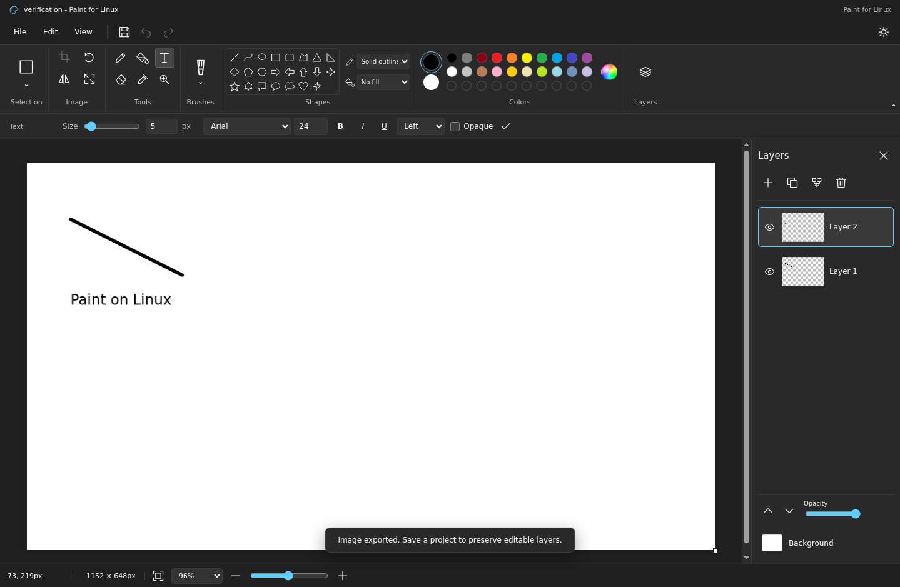

# Paint for Linux

A local drawing editor inspired by modern Microsoft Paint, with brushes, shapes, selections, text and layers. It runs as a Linux desktop app or in a browser.

Version: 0.1.0
<!-- paint-linux-version: 0.1.0 -->

This is an independent project, not a Microsoft product. It does not yet reproduce every Microsoft Paint feature or behavior. [PARITY.md](PARITY.md) records the reference, implemented features, remaining differences and verification scope.



## Download for Linux

Download the [v0.1.0 Linux x86-64 archive](https://github.com/stack-junkie/paint-linux/releases/download/v0.1.0/paint-linux-0.1.0-linux-x64.tar.gz) from [Releases](https://github.com/stack-junkie/paint-linux/releases/tag/v0.1.0). The release includes a SHA-256 checksum.

```sh
tar -xzf paint-linux-0.1.0-linux-x64.tar.gz
./paint-linux/run-paint.sh
```

The archive bundles Electron, so Node.js is not needed to run it. Use a normal desktop user. This is an early release; the tested platform is Ubuntu 22.04 x86-64 in an isolated Xvfb environment.

The host needs Electron's GTK, NSS, X11 and ALSA system libraries. Ubuntu 22.04 package names include `libgtk-3-0`, `libnss3`, `libatk-bridge2.0-0`, `libxdamage1` and `libasound2`; names vary by distribution. The launcher keeps Chromium sandboxing enabled and does not add `--no-sandbox`.

## Features

- Pencil, brush, eraser, calligraphy, airbrush, oil, crayon, marker, natural pencil and watercolor tools.
- 23 shapes, curves and polygons, with outline and fill controls.
- Fill tolerance, color picker, palette and custom colors, tool sizes and opacity.
- Multiline text with font, size, bold, italic, underline, alignment and background controls.
- Rectangular and free-form selections, inverse selection, transparency, move, resize, crop, copy, cut and paste.
- Image rotation, flips, resize, skew, color inversion and canvas resizing.
- Layer creation, duplication, reordering, naming, visibility, opacity, merging and transparent backgrounds.
- Undo/redo, editable `.linuxpaint` projects, native file dialogs, clipboard and print integration.
- Dark and light themes, zoom, grid, rulers, full screen and a collapsible toolbar.

Brush textures and rendering are independent approximations. See [known differences](PARITY.md#still-different-or-unresolved) for the limits of these features.

## Run from source

Use the Node.js version pinned in `.nvmrc` (24.14.0) and npm.

```sh
git clone https://github.com/stack-junkie/paint-linux.git
cd paint-linux
npm ci
npm run dev
```

Open the local URL printed by Vite for the browser edition. To run the desktop edition:

```sh
npm run build
npm run desktop
```

On Linux, build the unpacked app and portable archive:

```sh
npm run package:linux
npm run archive:linux
```

The output is under `release/`, including the portable `.tar.gz` archive and its `.sha256` checksum. The archive command runs on Linux after packaging and includes the launcher, documentation and license notices. Release archives are attached to GitHub Releases and are not stored in Git.

## File formats and local data

| Format | Open | Save | Notes |
| --- | --- | --- | --- |
| PNG | Yes | Yes | Preserves transparency. |
| JPEG | Yes | Yes | Saving flattens transparency against white. |
| WebP | Yes | Yes | Preserves transparency. |
| BMP | Yes | Yes | Saves an uncompressed 24-bit bitmap, flattened against white. |
| GIF | One frame | One frame | Fixed palette, no dithering or animation. Alpha below 128 becomes transparent; other pixels become opaque. |
| TIFF | No | Yes | Single-page, uncompressed 8-bit RGBA with unassociated alpha and 96 DPI tags. |
| `.linuxpaint` | Yes | Yes | This editor's layered project format. |
| Microsoft `.paint` | No | No | Interoperability is not implemented. |

Image import uses Chromium's decoders. GIF export uses 216 RGB cube colors, 39 grayscale colors and one transparent entry. Its bounded literal LZW encoder favors predictable memory over compression ratio.

Images and projects stay on the local computer. The desktop renderer is sandboxed, uses context isolation and accesses files through a narrow preload API and native dialogs. It does not expose Node.js or arbitrary paths to the page. External navigation and new windows are blocked. Desktop saves write and sync an exclusively created sibling file before replacing the destination, preserving the previous file if writing fails. The browser edition initiates downloads; the browser controls their destination and completion.

Projects store canvas dimensions, background, active layer and ordered layers with PNG pixels in `.linuxpaint` JSON. A `null` background means transparent. File operations accept up to 64 MiB of encoded data. Images may be up to 16384 pixels per side and 32 million total pixels. Documents support up to 64 layers within a shared 128 MiB pixel budget for layers and floating selections. Undo history has a separate 128 MiB budget. These budgets exclude browser, renderer, temporary encoding and other process overhead.

Clipboard access requires browser support and permission. Printing depends on the browser or operating system print service.

## Verification and known limits

The packaged app was exercised on Ubuntu 22.04 under Xvfb: drawing, undo/redo, layers, text, native project save/reopen, clipboard, PNG reopen, and PNG/JPEG/WebP/BMP/GIF/TIFF export passed. The harness supplied native chooser responses while exercising the real preload IPC, codecs and filesystem. Atomic-save tests also ran on Linux.

These checks do not establish identical behavior on every Linux desktop or full Microsoft Paint parity. Physical printing, Wayland, ARM and complete accessibility support remain unverified. Microsoft accounts, sharing, cloud synchronization, Cocreator, Image Creator, generative fill/erase, object selection and AI background removal are absent. Exact brush rasterization, text metrics, color management, metadata preservation and all command edge cases are not proven equivalent. Full details are in [PARITY.md](PARITY.md).

For local checks:

```sh
npm run hooks:install
npm run version:check
npm run test:files
npm test
npm run build
```

`npm test` runs real canvas and UI workflows in headless Chrome and writes `output/verification.json`. It uses installed Google Chrome by default; set `PAINT_CHROME_PATH` to choose another installed Chromium executable. It does not open a visible browser. `npm run test:files` checks native atomic-save behavior using Node.js and temporary files.

`npm run test:linux` targets a separately prepared, disposable Linux Xvfb container at loopback ports 9229 and 9231. It writes `output/linux-verification.json`. See [CONTRIBUTING.md](CONTRIBUTING.md#isolated-linux-verification) for the harness requirements; do not point it at a personal desktop session.

## Contributing and license

See [CONTRIBUTING.md](CONTRIBUTING.md) for development and reporting guidance, [SECURITY.md](SECURITY.md) for private vulnerability reports, and [ATTRIBUTION.md](ATTRIBUTION.md) for reference and dependency notices.

Released under the [MIT license](LICENSE).
